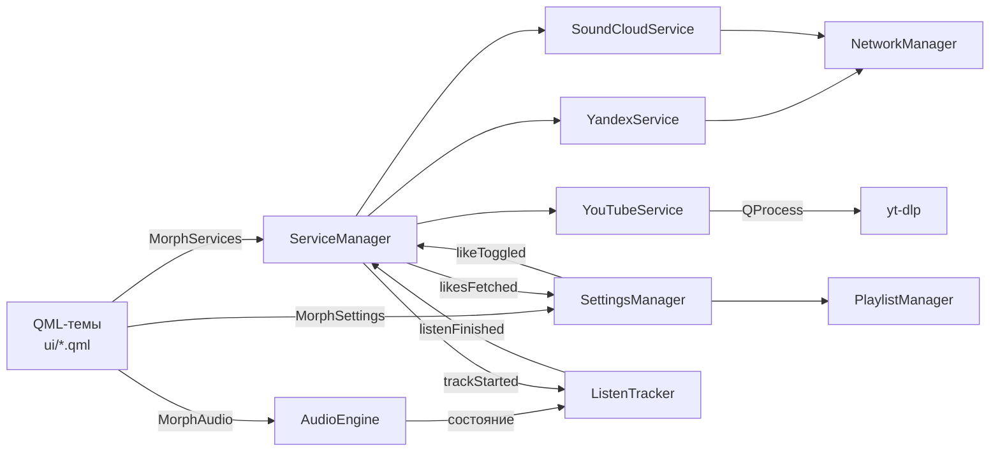
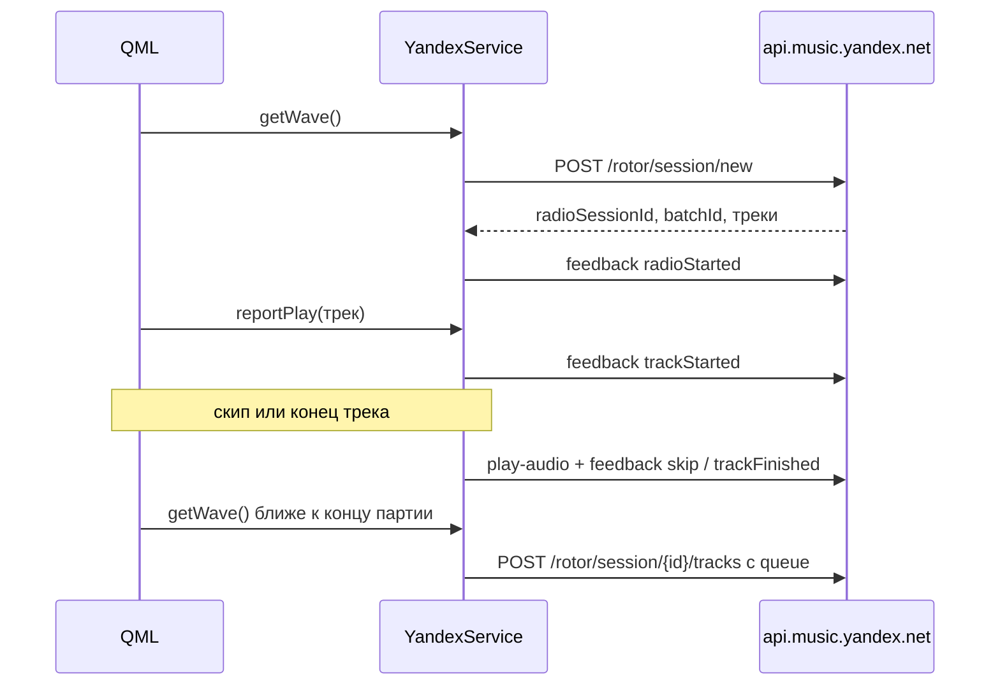
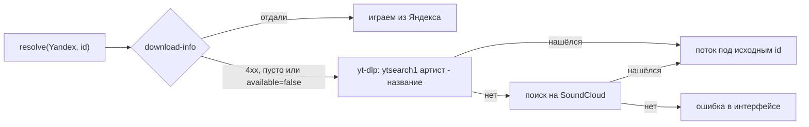

# Как устроен morph

Qt/QML-плеер. Интерфейс целиком в QML (`ui/`), вся логика в C++ (`src/`),
QML видит её через объекты контекста `MorphServices`, `MorphSettings`,
`MorphAudio` и другие.

`ServiceManager` держит сервисы в одном реестре и маршрутизирует вызовы QML по
полю `service` трека. Всё, кроме `main.cpp`, собирается в статическую
библиотеку `morph_core`, её же линкуют тесты
([ADR-0002](adr/0002-core-as-static-library.md)).

## Что уходит в Яндекс

**Прослушивания.** QML сообщает о треке в момент старта (`reportPlay`), а
`ListenTracker` считает, сколько его реально слушали, без пауз. Когда трек
пропущен или доигран, `play-audio` уходит с настоящими секундами и id альбома.

**Моя волна** идёт через rotor-сессию
([ADR-0003](adr/0003-wave-through-rotor-sessions.md)):

**Лайки** синхронизируются в обе стороны, источник правды на стороне сервиса
([ADR-0004](adr/0004-likes-source-of-truth.md)). Дизлайк уходит и в коллекцию,
и событием в волну.

## Треки, которых нет в Яндексе

Поток всегда приходит под исходным id трека
([ADR-0005](adr/0005-fallback-under-original-id.md)), поэтому QML, кэш и
плейлисты ничего не знают о подмене. Импорт `.txt` со строками
«артист - название» создаёт YouTube-треки с id вида `ytq-<base64 запроса>`,
которые ищутся в момент запуска по той же цепочке.

## macOS

`MprisManager` на маке вместо DBus поднимает `MacNowPlaying`
(`MPRemoteCommandCenter` и `MPNowPlayingInfoCenter`): медиаклавиши, кнопки
наушников и виджет «Сейчас играет» с обложкой. Ключ шифрования токена
выводится из IOPlatformUUID, а не из hostname, который на маке меняется
вместе с сетью.
