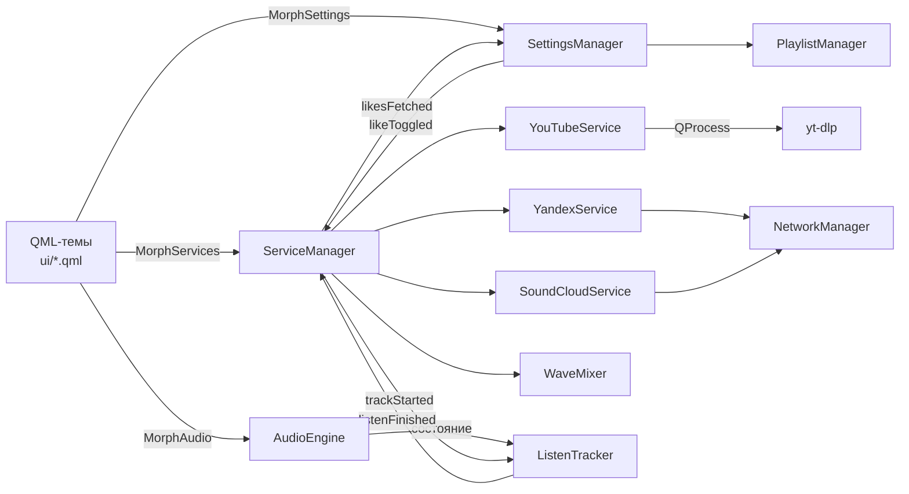
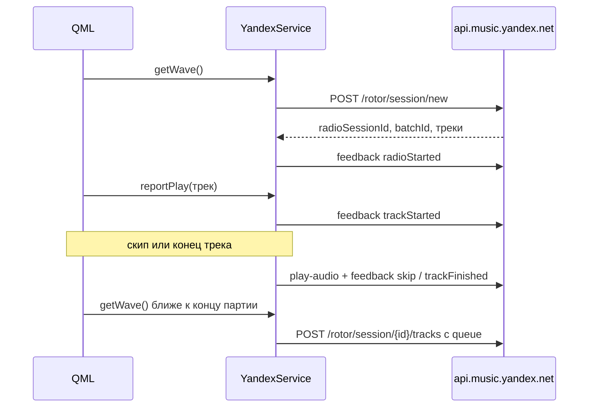
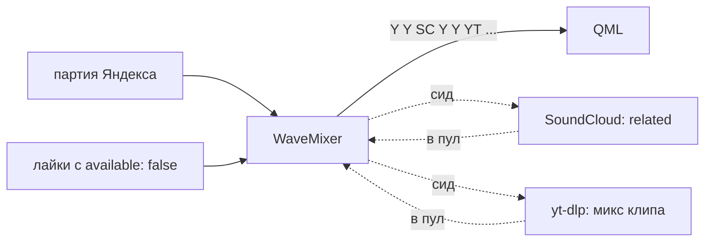
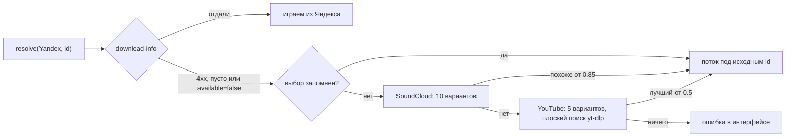
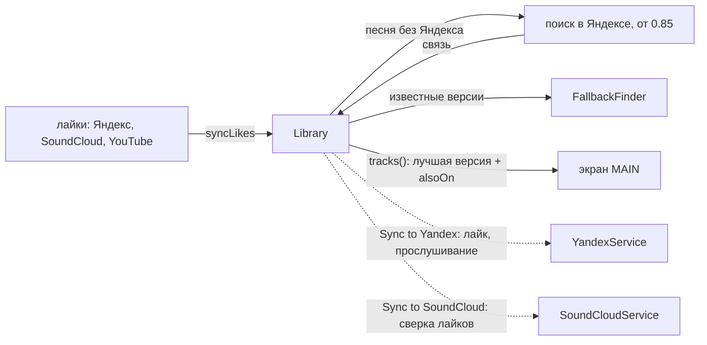
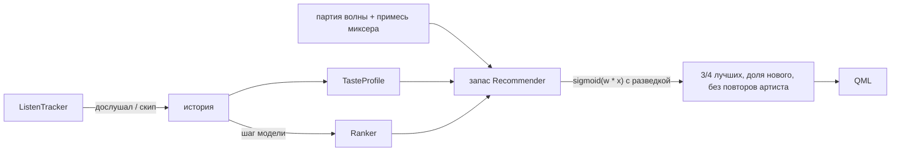
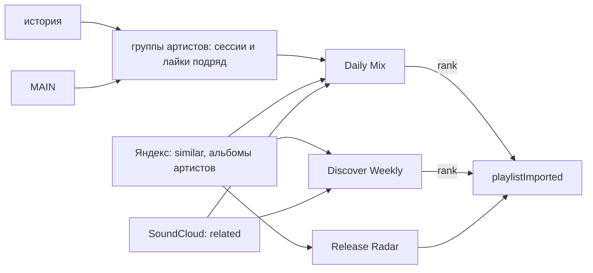

# Как устроен morph

Qt/QML-плеер. Интерфейс целиком в QML (`ui/`), вся логика в C++ (`src/`),
QML видит её через объекты контекста `MorphServices`, `MorphSettings`,
`MorphAudio` и другие.

`ServiceManager` держит сервисы в одном реестре и маршрутизирует вызовы QML по
полю `service` трека. Всё, кроме `main.cpp`, собирается в статическую
библиотеку `morph_core`, её же линкуют тесты
([ADR-0002](adr/0002-core-as-static-library.md)).

## Что уходит в Яндекс

**Прослушивания.** QML сообщает о треке в момент старта (`nowPlaying`), а
`ListenTracker` считает, сколько его реально слушали, без пауз. Когда трек
пропущен или доигран, `play-audio` уходит с настоящими секундами и id альбома.

**Моя волна** идёт через rotor-сессию
([ADR-0003](adr/0003-wave-through-rotor-sessions.md)):

**Станции и волны по треку.** Та же сессия создаётся по любым сидам:
`user:onyourwave` для Моей волны, `track:ID` и `artist:ID` из меню трека,
`genre:rap` или `activity:workout` для станций на главной. Список станций и
варианты настроек Моей волны (характер, настроение, язык) приходят из
`/rotor/wave/settings` и `/rotor/stations/dashboard`, выбранные настройки
уходят в сессию сидами вида `settingDiversity:discover`. При смене станции
старая сессия бросается, а её запоздалые ответы отсекает номер поколения.

**Смешанная волна.** Партии из сессии проходят через `WaveMixer`: треки Яндекса
идут как есть, а между ними похожее с SoundCloud и YouTube и лайки, которые
Яндекс убрал из каталога ([ADR-0007](adr/0007-mixed-wave.md)).

Сидом служит дослушанный или лайкнутый трек, по очереди с убранными лайками.
Поиск идёт в фоне, поэтому первая партия приходит без задержки.

Похожее с SoundCloud и YouTube до пула проходит `CandidateFilter`: мусор
выкидывается, подпись чинится, а трек ищется в каталоге Яндекса и, если там
есть, играет оттуда ([ADR-0015](adr/0015-candidate-filter.md)). Поле `via`
помнит, кто посоветовал: по нему ранжирование держит треть волны за
SoundCloud и YouTube.

**Лайки** синхронизируются в обе стороны, источник правды на стороне сервиса
([ADR-0004](adr/0004-likes-source-of-truth.md)). Дизлайк уходит и в коллекцию,
и событием в волну.

## Треки, которых нет в Яндексе

Поток всегда приходит под исходным id трека
([ADR-0005](adr/0005-fallback-under-original-id.md)), поэтому QML, кэш и
плейлисты ничего не знают о подмене. Какой вариант играет, решает
`FallbackFinder`: сравнивает с исходным треком название, артиста и
длительность (`TrackMatch::score`) и запоминает выбор в
`fallback_choices.json` ([ADR-0009](adr/0009-fallback-version-matching.md)).
Импорт `.txt` со строками «артист - название» создаёт YouTube-треки с id вида
`ytq-<base64 запроса>`, которые ищутся в момент запуска тем же способом.

Если песня есть в MAIN, её известные версии с других площадок пробуются
раньше поиска. Так же работает и обратное: трек, удалённый с SoundCloud или
YouTube, играет версией из Яндекса.

yt-dlp запускается через очередь в `YouTubeService`: у трека один процесс,
включённый трек ищется сразу, а следующий, который QML просит через
`prefetch`, ждёт своей очереди и после поиска сразу качается в кэш
([ADR-0008](adr/0008-yt-dlp-queue-and-fast-client.md)).

## MAIN

`Library` (в QML `MorphLibrary`) собирает лайки всех сервисов в одну
библиотеку, где песня это одна запись
([ADR-0012](adr/0012-main-library.md)).

Сверка с площадками описана в [ADR-0016](adr/0016-main-on-every-service.md).

## История и профиль вкуса

QML сообщает о старте трека через `nowPlaying(трек)`, и когда трек доигран
или пропущен, событие с артистом, названием и прослушанными секундами
ложится в `listening.jsonl` (`ListeningHistory`, последние 10 000 событий).
Туда же идут лайки и дизлайки со всех площадок. `TasteProfile` считает по
ней, насколько ты любишь каждого артиста: лайки за всё время плюс недавние
прослушивания, вес которых вдвое падает за 30 дней. Дослушал плюс, ушёл в
первые полминуты минус, дизлайк сильный минус.

## Ранжирование

Сервисы поставляют кандидатов, порядок решает `Recommender`
([ADR-0013](adr/0013-own-ranking-over-services.md)). Его модель `Ranker`
предсказывает, дослушаешь ли трек, и учится после каждого.

## Плейлисты от morph

`MorphMixes` собирает Daily Mix, Discover Weekly, Release Radar, On Repeat и
Rediscover ([ADR-0014](adr/0014-morph-playlists.md)). Карточки уходят в
`dailyMixesReady` с сервисом `morph` вместе с миксами сервисов, а клик по
карточке зовёт `importPlaylist("morph:...")`.

## Интерфейс

Каждая из трёх тем (`style.qml`, `style_white.qml`, `auto_theme.qml`) это
целое приложение на QML, поэтому новые крупные куски интерфейса лежат в
`ui/components` и подключаются во все темы одной строкой с цветами темы
([ADR-0010](adr/0010-shared-qml-components.md)).

Очередь «играть следующим» и перемешивание живут в C++ (`PlaybackQueue`, в
QML это `MorphQueue`), а список, который играет, остаётся в QML. Очередь
проигрывается поверх списка, потом список продолжается с того же места.
Перемешивание даёт каждому треку сыграть по разу за круг, а «назад» идёт по
тому, что реально играло. Боковая панель (`SidePanel`) показывает текущий
трек, очередь и продолжение списка, на второй вкладке текст песни
(`LyricsService`: Яндекс, потом LRCLIB, [ADR-0011](adr/0011-lyrics-yandex-and-lrclib.md)).

Над треками плейлиста `PlaylistToolbar`: поиск, сортировка (`arrangeTracks`
в C++, по алфавиту через `QCollator`) и волна по плейлисту. Такая волна
своя: `MorphMixes` берёт похожее на три случайных трека плейлиста и пару
его собственных, а дальше всё идёт через тот же запас и ранжирование, что и
волна Яндекса. Пока она играет, `getWave` просит следующую партию у неё.

Страница артиста (`ArtistPage`) открывается во всех темах. Данные одним
запросом `/artists/{id}/brief-info`: популярные треки, альбомы, похожие
артисты, жанры, слушатели за месяц. id берётся у трека, если нажали на его
первого артиста, иначе поиском по имени. Нет артиста в Яндексе, страница
собирается из поиска на SoundCloud. Сверху `ServiceManager` кладёт своё:
песни артиста в MAIN и сколько раз он играл. Альбом открывается как плейлист
через `openAlbum`.

## macOS

`MprisManager` на маке вместо DBus поднимает `MacNowPlaying`
(`MPRemoteCommandCenter` и `MPNowPlayingInfoCenter`): медиаклавиши, кнопки
наушников и виджет «Сейчас играет» с обложкой. Ключ шифрования токена
выводится из IOPlatformUUID, а не из hostname, который на маке меняется
вместе с сетью.
